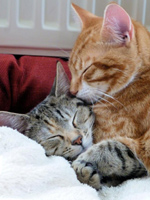

Hi, I'm Karen. Being away on holiday, or out at work all day, shouldn't mean worrying about your pets. I visit them in their own home, so they keep their usual routine and surroundings, which is far less stressful for them, especially cats.

Every visit is tailored to your pets: feeding and fresh water, litter trays or toilet breaks, any medication they need, and plenty of fuss for those who want it. I charge per visit, not per animal, and I can send you a photo or a quick text so you know all is well.

It all starts with a [free consultation](/contact/#contact-form), where I meet your pets and we agree what they need.
