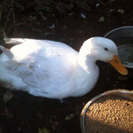

It's not just cats and dogs that need care, love and attention when you are away from home or on holiday. I am able to look after a variety of small animals and give them the individual care and attention they need to. Small animal clients have included rabbits, a tortoise, a variety of ducks, guinea pigs and fish. Soon there will be chickens that I will be looking after too.

Even with other smaller animals I still offer a [free consultation](/contact/) to ensure I look after them just as you do. Any pet misses its owner when they are home alone so again keeping them relaxed and happy in their own home is my priority.
